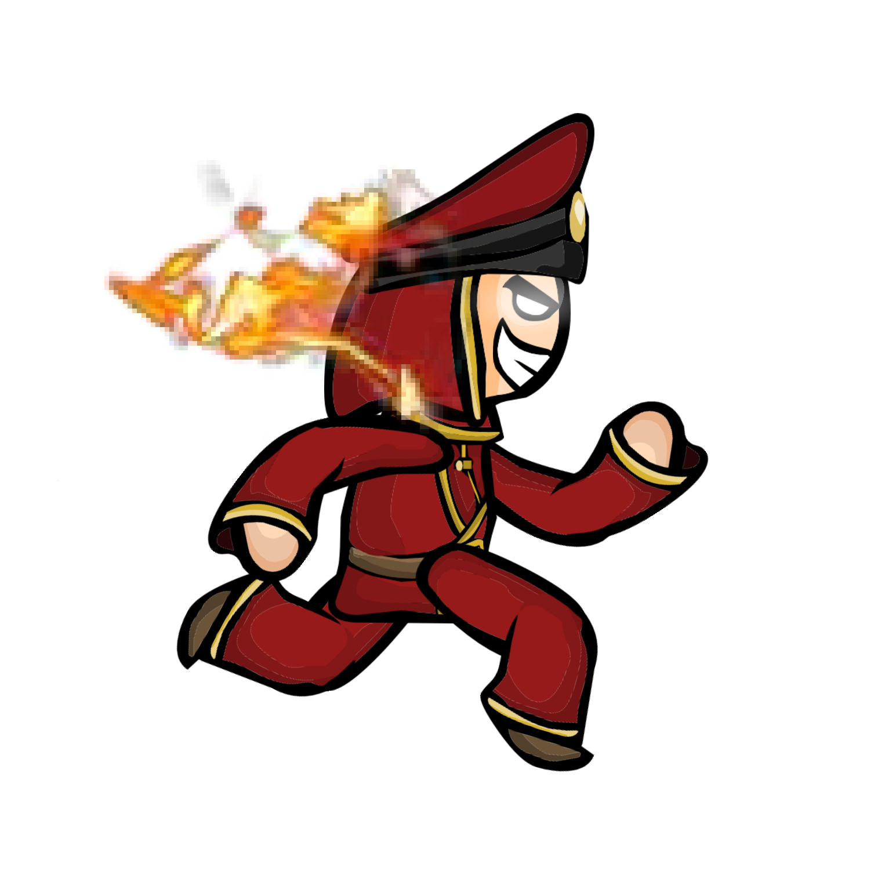
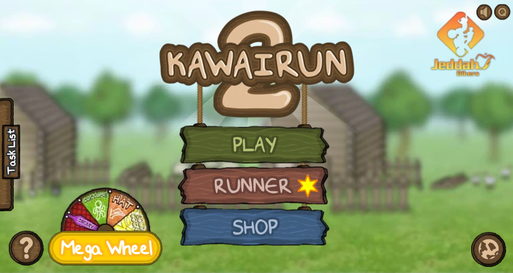
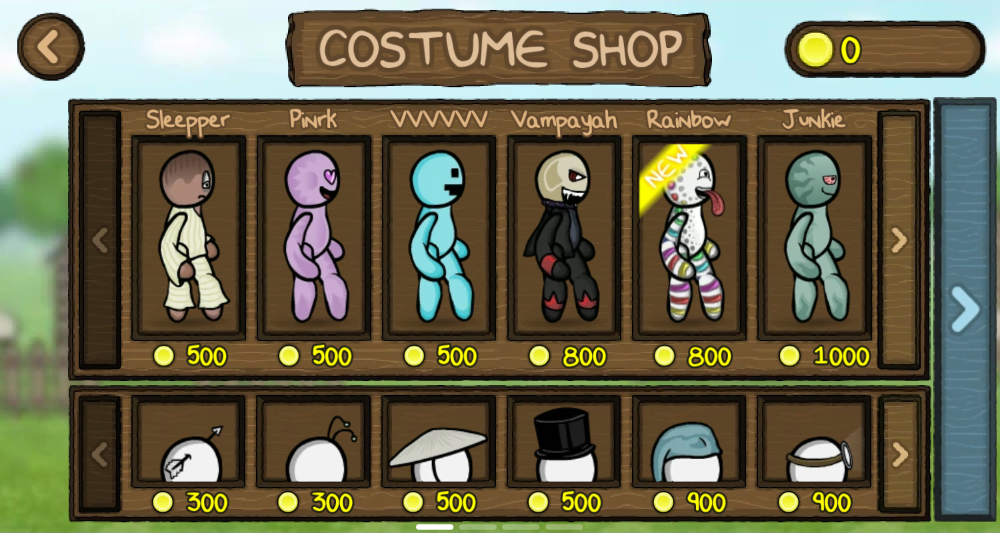
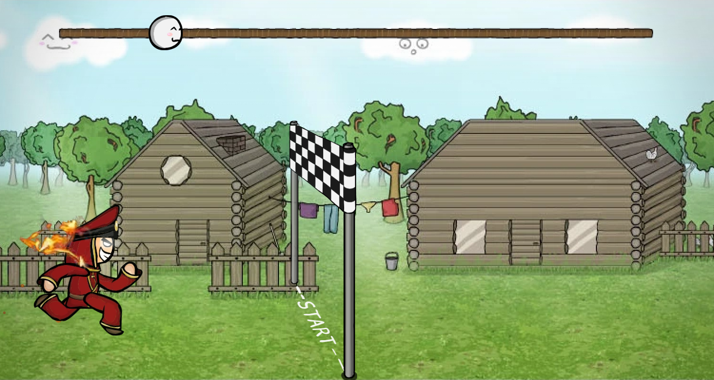
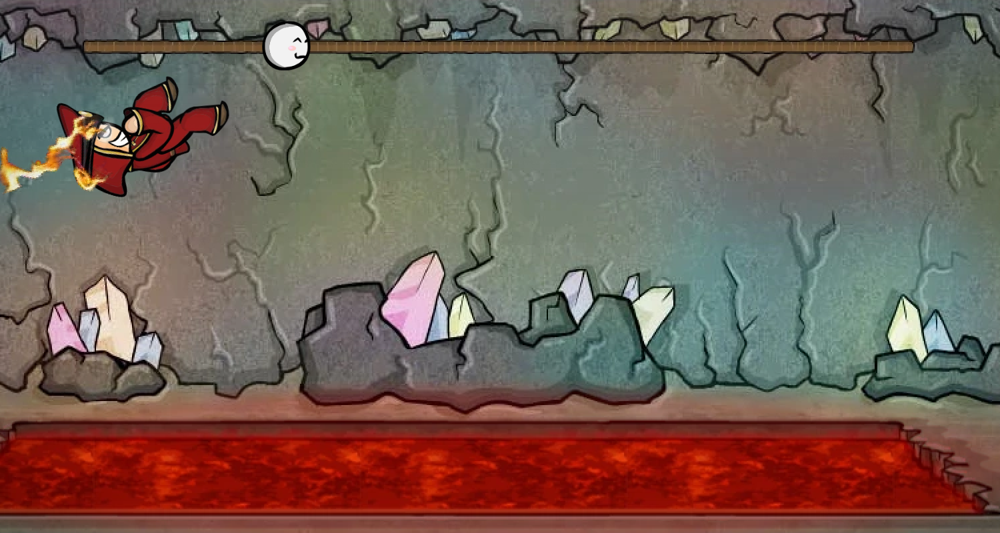

<div align="center">
  
  <h1>Pixi Run 2</h1>
</div>

Pixi Run 2 is a remake of the Flash game Kawai Run 2, written in TypeScript with PixiJS.

It has all the levels, survival mode, the shop, the costume editor, and online play with login, lobby and multiplayer.

<p align="center">
  
  
  
  
</p>

To run it, build the game and serve the `public` folder:

```
cd remake
npm install
npx esbuild src/main.ts --bundle --minify --outfile=public/game.js --target=es2019 --loader:.json=json
cd public && python3 -m http.server 8770
```

Then open http://127.0.0.1:8770 in your browser. If you want every skin and hat unlocked, add `?unlockall` to the end of the address.

The code is in `remake/src`, and everything the game loads (art, audio, data and the built `game.js`) is in `remake/public`.

This is a fan project and isn't affiliated with the original game or its creators.
